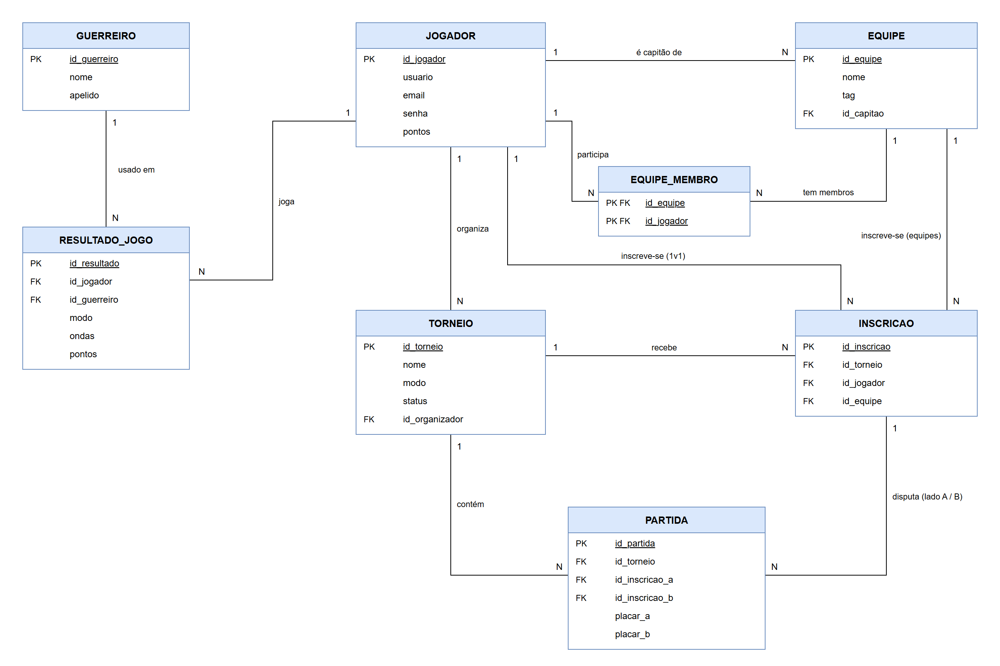

# Rivals Arena

Site publicado: https://fidamaa.github.io/rivals-arena/

Jogo Bellator no itch.io: https://dedechi.itch.io/bellator

## Descrição

O Rivals Arena é um site de competições para o jogo Bellator, parecido com as plataformas de
campeonatos de e-sports. Nele os jogadores podem criar torneios, se inscrever sozinhos ou com um
time, acompanhar o chaveamento e as partidas e ver o ranking.

O Bellator é o jogo que a nossa equipe desenvolveu em Unity. É um jogo de luta em terceira pessoa
que se passa no Coliseu de Roma, e o nome vem do latim ("aquele que guerreia"). Ele está publicado
no itch.io e pode ser jogado direto pelo site.

Para testar sem criar conta, entre na tela de login e use o botão "Entrar com conta de demonstração".

## Objetivo

A ideia do projeto é juntar em um lugar só tudo o que a comunidade do Bellator precisa para
organizar campeonatos. Hoje isso costuma ser feito com planilhas e grupos de mensagem, o que dá
bastante trabalho. No Rivals Arena o organizador cria o torneio, os jogadores se inscrevem, o
chaveamento é montado sozinho e o ranking é atualizado conforme os resultados são enviados.

## Funcionalidades

- Cadastro, login e conta de demonstração
- Perfil do jogador com pontos, posição no ranking, vitórias, derrotas, títulos, times e histórico
- Criação de torneios (1v1, 2v2 ou 3v3), com modo de jogo, formato, número de vagas, data e premiação
- Lista de torneios com busca e filtros
- Inscrição de jogadores e de times (no caso de times, quem inscreve é o capitão)
- Chaveamento automático em mata-mata, ou tabela de pontos corridos
- Página da partida com placar, escolha do guerreiro, chat e envio do resultado
- Criação e gerenciamento de times (até 6 membros)
- Ranking de jogadores, de times e do jogo Bellator
- Página para jogar o Bellator dentro do site, que também funciona no celular
- Envio dos resultados do jogo para o ranking do site
- Notificações e painel do jogador
- Notícias, página do jogo, suporte com formulário e páginas de termos e privacidade

## Tecnologias utilizadas

- HTML, CSS e JavaScript (sem frameworks)
- localStorage do navegador para guardar os dados nesta versão
- MySQL para a modelagem do banco de dados
- Unity (C#) para o jogo, publicado no itch.io
- Figma para o protótipo das telas
- Git, GitHub e GitHub Pages para versionar e publicar o site

## Modelagem do banco de dados

A modelagem está na pasta `documentacao`:

- `01-modelagem-conceitual.md`: entidades, relacionamentos e regras do sistema
- `02-modelagem-logica.md`: tabelas, campos, tipos e chaves
- `03-DER.md`: diagrama entidade-relacionamento

O banco tem 14 tabelas. As principais são jogador, equipe, equipe_membro, torneio, inscricao,
partida, guerreiro e resultado_jogo.



Nesta versão, o site ainda não tem servidor, então os dados ficam salvos no próprio navegador.
A estrutura usada é a mesma do banco: cada tabela corresponde a uma lista dentro do arquivo
`js/banco.js`. Os scripts SQL servem para criar esse banco no MySQL, quando o projeto tiver um
back-end.

## Arquivos adicionais

Na pasta `arquivos-adicionais` estão:

- `sql/01_criacao_banco.sql`: cria o banco e as tabelas
- `sql/02_insercao_dados.sql`: insere os dados de exemplo
- `sql/03_consultas_exemplo.sql`: algumas consultas de teste
- `INSTALACAO.md`: como instalar, configurar e usar o sistema

## Como executar

O jeito mais fácil é acessar o link do site publicado. Para rodar no computador, basta baixar o
projeto e abrir o arquivo `index.html` no navegador. O passo a passo completo, incluindo o banco
de dados, está em `arquivos-adicionais/INSTALACAO.md`.

## Estrutura de pastas

```
css/                  estilos do site
js/                   scripts (dados.js, banco.js, comum.js e um arquivo para cada página)
img/                  imagens
integracao-unity/     arquivos para ligar o jogo ao site
documentacao/         modelagem do banco
arquivos-adicionais/  scripts SQL e instruções de instalação
```

## Equipe

- Integrante 1
- Integrante 2
- Orientador(a):

Trabalho de Conclusão de Curso (TCC).
