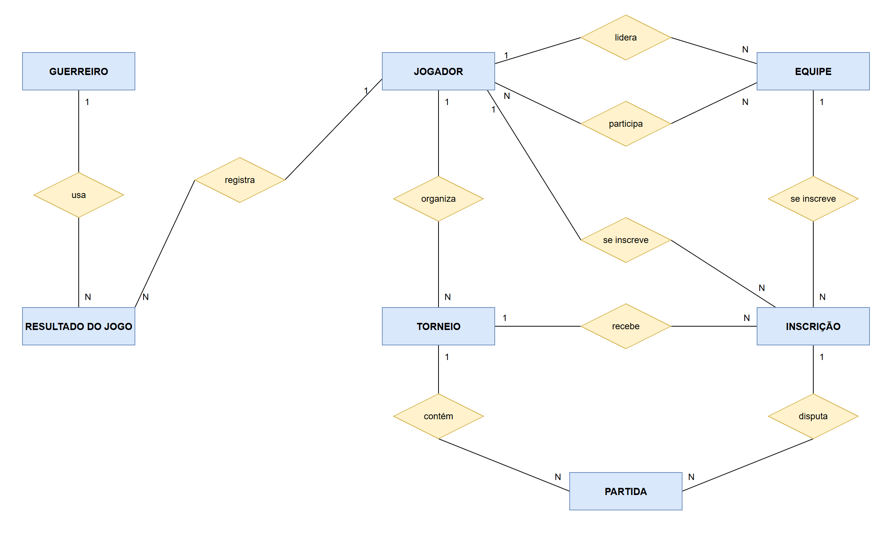

# Modelagem Conceitual

Nesta etapa levantamos quais informações o sistema precisa guardar e como elas se relacionam,
sem pensar ainda em tabelas ou tipos de dados.

## Entidades

- **Jogador:** a conta de cada usuário. Guarda usuário, nome, e-mail, senha, bio e as estatísticas
  (pontos, vitórias, derrotas e títulos).
- **Guerreiro:** os quatro personagens do Bellator (Secutor, Retiarius, Sagittarius e Dimachaerus),
  com nome, apelido e os atributos de força, agilidade e resistência.
- **Equipe:** os times (no site aparecem como "Times"). Guarda nome, sigla (tag), cor e estatísticas.
- **Torneio:** o campeonato criado por um jogador. Tem nome, modo (1v1, 2v2 ou 3v3), modo de jogo,
  formato, número de vagas, data de início, premiação e status.
- **Inscrição:** a participação em um torneio. Pode ser de um jogador (torneio 1v1) ou de uma
  equipe (torneios 2v2 e 3v3).
- **Partida:** um confronto entre duas inscrições dentro de um torneio, com rodada, placar, status
  e horário.
- **Resultado do jogo:** o resultado de uma partida jogada no Bellator, enviado pelo próprio jogo
  (modo, ondas, pontos e se venceu).
- **Mensagem:** as mensagens do chat de cada partida.
- **Notificação:** avisos para o jogador, como "o seu torneio começou".
- **Notícia:** as publicações da página de novidades.
- **Chamado:** as mensagens enviadas pelo formulário de suporte.
- **Interessado:** os e-mails de quem quer receber novidades do jogo.

## Relacionamentos

- Um jogador pode ser **capitão** de várias equipes, e cada equipe tem um capitão (1:N).
- Um jogador pode **participar** de várias equipes, e uma equipe tem vários jogadores (N:N).
- Um jogador **organiza** vários torneios, e cada torneio tem um organizador (1:N).
- Um torneio **recebe** várias inscrições (1:N). Cada inscrição é de um jogador ou de uma equipe,
  nunca dos dois ao mesmo tempo.
- Um torneio **contém** várias partidas (1:N).
- Cada partida tem duas inscrições se enfrentando, o lado A e o lado B.
- No mata-mata, o vencedor de uma partida **avança** para a partida seguinte (a partida se
  relaciona com ela mesma).
- Quando o torneio termina, uma inscrição fica marcada como **campeã**.
- Em cada partida, cada jogador **escolhe** um guerreiro.
- Um jogador **envia** mensagens no chat de uma partida.
- Um jogador **registra** vários resultados do jogo, e cada resultado pode estar ligado a um
  guerreiro.
- Um jogador **recebe** várias notificações.
- Um jogador pode **abrir** chamados no suporte. Quem não tem conta também pode.
- Notícia e Interessado não se relacionam com as outras entidades.

## Regras do sistema

1. Não podem existir dois jogadores com o mesmo usuário ou o mesmo e-mail, nem duas equipes com o
   mesmo nome ou a mesma sigla.
2. Uma equipe tem no máximo 6 membros, e o capitão também conta como membro.
3. Torneios 1v1 recebem inscrições de jogadores. Torneios 2v2 e 3v3 recebem inscrições de equipes,
   e a equipe precisa ter pelo menos 2 ou 3 jogadores.
4. O mesmo participante não pode se inscrever duas vezes no mesmo torneio.
5. O torneio passa por três situações: inscrições abertas, em andamento e finalizado.
6. A partida pode estar aguardando adversário, agendada ou finalizada. Não existe empate.
7. No ranking, cada vitória vale 25 pontos, cada derrota tira 15 e quem vence o torneio ganha 100.
8. No ranking do Bellator vale o melhor resultado de cada jogador em cada modo.
