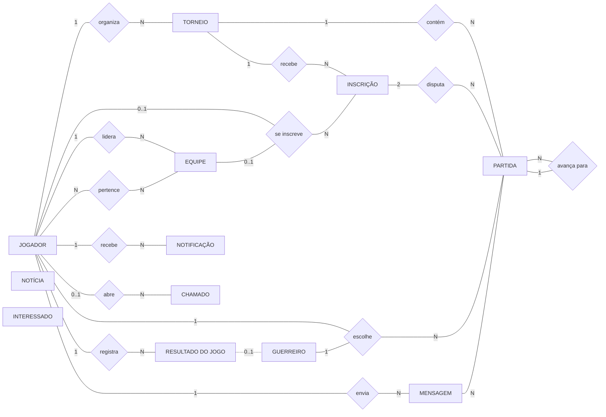

# Modelagem Conceitual — Rivals Arena

A modelagem conceitual descreve **o que** o sistema precisa guardar, sem se preocupar com
tipos de dados ou com o banco escolhido. Ela foi feita a partir das regras do site
(arquivo `js/banco.js`).

> O diagrama acima também está no fim deste arquivo em formato Mermaid (o GitHub desenha
> ele automaticamente).

## Entidades

| Entidade | O que representa | Principais atributos |
|---|---|---|
| **JOGADOR** | Uma conta de usuário da plataforma | usuário, nome, e-mail, senha, bio, pontos, vitórias, derrotas, títulos |
| **GUERREIRO** | Um dos 4 personagens do Bellator (Secutor, Retiarius, Sagittarius, Dimachaerus) | nome, apelido, força, agilidade, resistência |
| **EQUIPE** | Um time de jogadores (no site: "Times") | nome, tag, cor, pontos, vitórias, derrotas, títulos |
| **TORNEIO** | Um campeonato criado por um jogador | nome, modo (1v1/2v2/3v3), modo de jogo, formato, vagas, início, premiação, status |
| **INSCRIÇÃO** | A participação de um jogador (1v1) ou de uma equipe (2v2/3v3) em um torneio | data da inscrição |
| **PARTIDA** | Um confronto entre duas inscrições dentro de um torneio | rodada, ordem, placar A e B, status, data e hora |
| **RESULTADO DO JOGO** | O resultado de uma partida jogada dentro do Bellator (enviado pelo jogo) | modo (sobrevivência/infinito), ondas, pontos, venceu, duração |
| **MENSAGEM** | Uma mensagem do chat de uma partida | texto, data |
| **NOTIFICAÇÃO** | Um aviso para um jogador (ex.: "seu torneio começou") | texto, link, lida |
| **NOTÍCIA** | Uma publicação da página Novidades | categoria, título, resumo, texto |
| **CHAMADO** | Uma mensagem enviada ao suporte | protocolo, assunto, mensagem |
| **INTERESSADO** | Um e-mail cadastrado para receber novidades do Bellator | e-mail |

## Relacionamentos e cardinalidades

| Relacionamento | Entidades | Cardinalidade | Explicação |
|---|---|---|---|
| **lidera** | JOGADOR — EQUIPE | 1 : N | Toda equipe tem exatamente 1 capitão; um jogador pode ser capitão de várias equipes. |
| **pertence** | JOGADOR — EQUIPE | N : N | Uma equipe tem de 1 a 6 membros; um jogador pode estar em várias equipes. Guarda a data de entrada. |
| **organiza** | JOGADOR — TORNEIO | 1 : N | Todo torneio tem 1 organizador; um jogador pode organizar vários torneios. |
| **recebe** | TORNEIO — INSCRIÇÃO | 1 : N | Um torneio recebe até "vagas" inscrições. |
| **se inscreve** | JOGADOR / EQUIPE — INSCRIÇÃO | 1 : N | Cada inscrição é de **um jogador OU uma equipe** (nunca os dois), conforme o modo do torneio. |
| **contém** | TORNEIO — PARTIDA | 1 : N | As partidas são criadas quando o organizador inicia o torneio. |
| **disputa** | INSCRIÇÃO — PARTIDA | 2 : N | Cada partida tem um lado A e um lado B (podem estar "a definir"). |
| **vence** | INSCRIÇÃO — PARTIDA | 1 : N | Uma partida finalizada tem 1 inscrição vencedora. |
| **avança para** | PARTIDA — PARTIDA | N : 1 (auto-relacionamento) | No mata-mata, o vencedor de duas partidas se encontra na partida seguinte. |
| **é campeã de** | INSCRIÇÃO — TORNEIO | 1 : 0..1 | Um torneio finalizado tem 1 inscrição campeã. |
| **escolhe** | JOGADOR — GUERREIRO — PARTIDA | ternário | Em cada partida, cada jogador escolhe 1 guerreiro. |
| **envia** | JOGADOR — MENSAGEM — PARTIDA | 1 : N | Chat da partida. |
| **registra** | JOGADOR — RESULTADO DO JOGO | 1 : N | Cada partida terminada no Bellator gera 1 resultado; pode estar ligado a 1 guerreiro e a 1 partida de torneio. |
| **recebe** | JOGADOR — NOTIFICAÇÃO | 1 : N | |
| **abre** | JOGADOR — CHAMADO | 0..1 : N | Visitantes sem conta também podem abrir chamados. |

## Regras de negócio que o modelo precisa respeitar

1. Nome de usuário e e-mail são únicos. Nome e tag de equipe são únicos.
2. Uma equipe tem no máximo 6 membros e sempre tem 1 capitão (que também é membro).
3. Torneio 1v1 recebe inscrições de **jogadores**; torneio 2v2/3v3 recebe inscrições de **equipes**,
   e a equipe precisa ter pelo menos 2 ou 3 membros.
4. O mesmo participante não pode se inscrever duas vezes no mesmo torneio.
5. Status do torneio: `inscrições abertas → em andamento → finalizado`.
6. Status da partida: `aguardando (lados a definir) → agendada → finalizada`. Não existe empate.
7. Pontuação do ranking: vitória +25, derrota −15, título +100.
8. O ranking do jogo Bellator considera o **melhor resultado** de cada jogador em cada modo.

## Diagrama (Mermaid)

`NOTÍCIA` e `INTERESSADO` são entidades independentes (não se relacionam com as outras).
