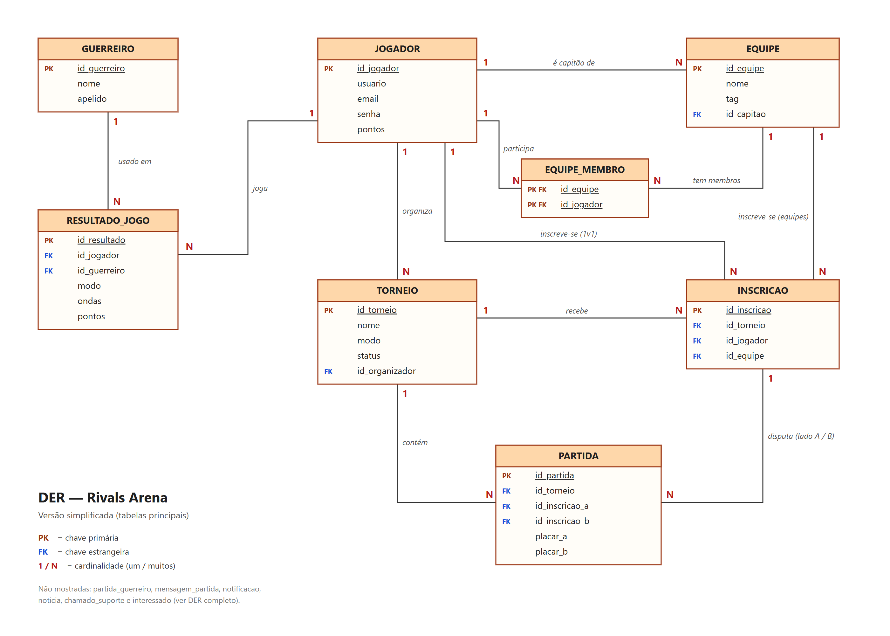
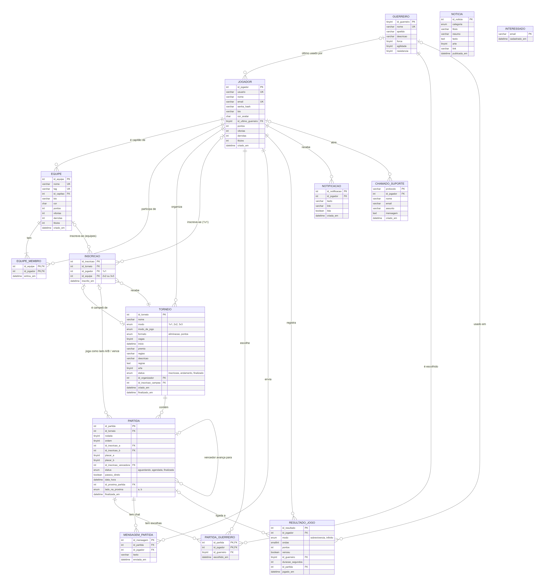
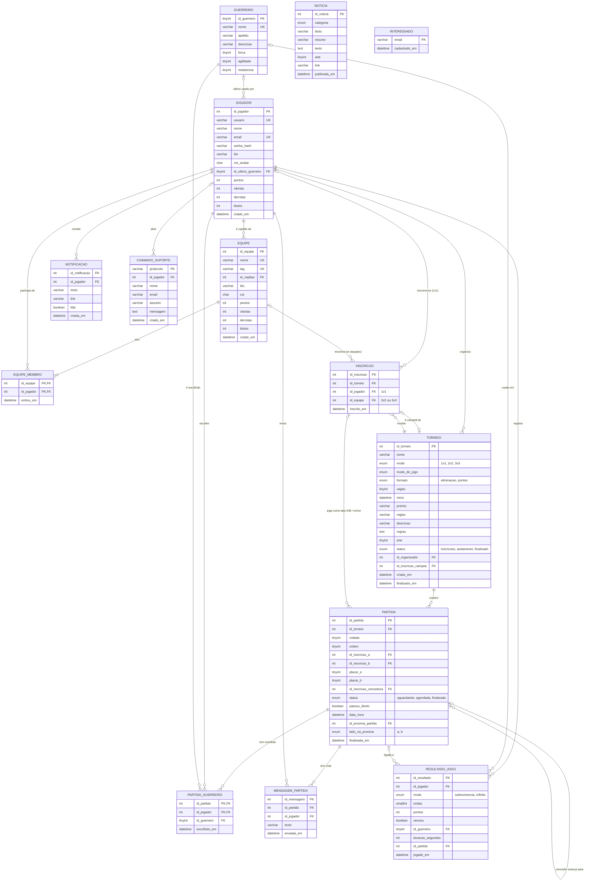

# DER — Diagrama Entidade-Relacionamento (Rivals Arena)

## DER simplificado

As tabelas principais do sistema, com as chaves e os campos mais importantes. As linhas indicam
os relacionamentos, e os números **1** e **N** indicam a cardinalidade (um / muitos).

Como ler:
- **JOGADOR 1 — N TORNEIO**: um jogador organiza vários torneios; cada torneio tem um organizador.
- **JOGADOR N — N EQUIPE**: resolvido pela tabela **EQUIPE_MEMBRO**. Uma equipe tem vários
  jogadores, e um jogador pode estar em várias equipes.
- **TORNEIO 1 — N INSCRICAO**: cada inscrição é de um jogador (torneio 1v1) **ou** de uma
  equipe (torneio 2v2/3v3).
- **TORNEIO 1 — N PARTIDA** e **INSCRICAO 1 — N PARTIDA**: cada partida tem dois lados (A e B),
  e cada lado é uma inscrição.
- **JOGADOR 1 — N RESULTADO_JOGO** e **GUERREIRO 1 — N RESULTADO_JOGO**: resultados enviados
  pelo jogo Bellator.

O arquivo [`DER-simplificado.svg`](DER-simplificado.svg) pode ser aberto e editado no draw.io
(diagrams.net) ou no Inkscape.

## DER completo

Diagrama no padrão "pé de galinha" (Crow's Foot), com **todas** as 14 tabelas e colunas. Ele
corresponde exatamente ao script
[`01_criacao_banco.sql`](../arquivos-adicionais/sql/01_criacao_banco.sql).

Como ler as linhas:
- `||--o{` : um (obrigatório) para muitos (opcional)
- `|o--o{` : zero ou um para muitos
- `||--|{` : um para um ou mais

`NOTICIA` e `INTERESSADO` não têm relacionamentos: são tabelas independentes.
